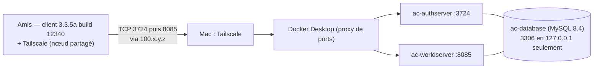

# Guide administrateur — serveur AzerothCore 3.3.5a privé (macOS + Docker + Tailscale)

Adapté à **cette installation** : MacBook Pro M1 Max (macOS 27.0.1), projet Docker Compose
`azerothcore-wotlk`, 6 joueurs, accès distant par Tailscale sans redirection de port.

Racine du projet : `/Users/test/Documents/git/wow/azerothcore-wotlk`
Toutes les commandes ci-dessous se lancent depuis cette racine.

---

## 1. Architecture



| Élément | Emplacement / valeur |
|---|---|
| Fichier Compose | `docker-compose.yml` (upstream) + `docker-compose.override.yml` (local, non versionné) |
| Configs serveurs | `env/dist/etc/{authserver,worldserver}.conf` (générées depuis les `.dist`, non versionnées) |
| Surcharges versionnées | `conf/dist/env.ac` (variables `AC_*`, prioritaires sur les `.conf`) |
| Données de jeu | volume Docker `azerothcore-wotlk_ac-client-data` (maps, vmaps, mmaps, dbc — v20.0) |
| Base de données | volume Docker `azerothcore-wotlk_ac-database` |
| Journaux | `env/dist/logs/{Server,Auth,DBImport,Errors}.log` |
| Mot de passe root MySQL | fichier `.env` (racine, permissions 600, non versionné) |
| Client data / IP LAN | 192.168.1.74 (DHCP — réserver l'adresse sur la box) |

---

## 2. Démarrer / arrêter / redémarrer

```bash
cd /Users/test/Documents/git/wow/azerothcore-wotlk

docker compose up -d                 # démarrer (ou appliquer une modif de config)
docker compose ps                    # état + ports publiés
docker compose restart ac-worldserver   # redémarrer le serveur de jeu (30 s)
docker compose stop                  # arrêter sans supprimer
docker compose start                 # redémarrer

# ⛔ NE JAMAIS FAIRE : docker compose down -v
#    (-v supprime les volumes = base de données + données de jeu définitivement)
```

Le worldserver est prêt quand `env/dist/logs/Server.log` affiche :
`WORLD: World Initialized …` puis `… (worldserver-daemon) ready...`

> ⚠️ **Piège vérifié en conditions réelles** : l'authserver marque le royaume **hors ligne**
> à son démarrage (`UPDATE realmlist SET flag = flag | 2`), et seul un démarrage du
> **worldserver** le repasse en ligne. Donc après tout `docker compose restart ac-authserver`,
> enchaîne par `docker compose restart ac-worldserver`, sinon les clients voient « Hors ligne ».
> Contrôle : `SELECT flag FROM acore_auth.realmlist WHERE id=1;` → doit valoir `0` (bit `2` = hors ligne).

Console administrative du serveur de jeu :

```bash
docker attach ac-worldserver
#   … commandes …
# Détacher : Ctrl+P puis Ctrl+Q   (Ctrl+C ARRÊTE le serveur)
```

---

## 3. Tailscale

```bash
export PATH="/Applications/Tailscale.app/Contents/MacOS:$PATH"   # CLI (variante Standalone)
tailscale status        # pairs, état direct/relay, IP de chaque machine
tailscale ip -4         # -> 100.100.203.120  (l'adresse à mettre dans realmlist)
```

- **Installation** : `brew install --cask tailscale-app` (variante Standalone, recommandée par
  Tailscale ; ne pas installer en plus la version Mac App Store). Autoriser l'extension réseau
  dans Réglages Système → Général → Ouverture et extensions → Extensions réseau.
  ⚠️ La connexion au compte se fait **depuis la barre de menus** (icône Tailscale → *Log in*) :
  `tailscale up` en ligne de commande échoue sur macOS (« *The Tailscale GUI failed to start:
  Tailscale.CLIError error 3* »).
- **Identité de cette installation** : compte `mael.donnart.pro@gmail.com`, machine
  `macbook-pro-de-mal`, IP tailnet `100.100.203.120`, nom MagicDNS
  `macbook-pro-de-mal.tail294391.ts.net` (tailnet `tail294391`).
- **Empêcher l'expiration de la clé du serveur** : la clé de `macbook-pro-de-mal` expire le
  **16/04/2027** ; passé ce délai la machine quitte le tailnet et plus personne ne peut se connecter.
  Console d'admin → Machines → `…` → **Disable key expiry** (documentation Tailscale : « *You can
  disable key expiry for certain types of devices where this is inconvenient, like servers.* »).
  À faire aussi pour le compte partagé : si un ami disparaît du tailnet tous les 180 jours, c'est
  cette expiration, pas une panne.
- **Autoriser les connexions entrantes** : laisser l'option active
  (`tailscale set --shields-up=false`). C'est la cause n°1 d'échec « le serveur ne répond pas ».
- **Ajouter un ami** : console <https://login.tailscale.com/admin/machines> → machine du Mac →
  menu `…` → **Share** → e-mail (lien à usage unique) ou **lien réutilisable** (valable 30 jours,
  jusqu'à 1000 usages). Le partage ne consomme **aucun** siège utilisateur du tailnet et l'ami
  n'accède qu'à cette machine. L'ami doit être propriétaire/admin de son propre tailnet pour accepter.
- **Retirer un ami** : admin.tailscale.com → **Sharing** → révoquer le partage.
- **Alternative** : inviter un ami comme utilisateur du tailnet (plan gratuit = 6 utilisateurs,
  soit toi + 5 : plus aucune marge). À réserver au cas où tu veux des ACL par utilisateur.

---

## 4. Comptes de jeu

Toujours via la console du worldserver (jamais en SQL direct) :

```bash
docker attach ac-worldserver
account create <compte> <motdepasse> <email>     # une fois par joueur
account set gmlevel <ton_compte> 3 -1            # administrateur (toi uniquement)
# Ctrl+P puis Ctrl+Q pour détacher
```

Autres commandes utiles : `account list`, `account set password`, `account set addon`, `server info`.
Le niveau 3 = administrateur ; `-1` = tous les royaumes.

Vérification :

```bash
docker exec -e MYSQL_PWD="$(grep '^DOCKER_DB_ROOT_PASSWORD=' .env | cut -d= -f2-)" ac-database \
  mysql -uroot -N -e "SELECT id, username FROM acore_auth.account"
```

Comptes créés le 18/10 : `mael`, `cedric`, `marine`, `anthony`, `jess`, `felix`
(mot de passe = nom du compte, `mael` en administrateur niveau 3). À communiquer aux joueurs
oralement ou par messagerie — à ne pas recopier dans un document partagé.

> ⚠️ **Pièges constatés en conditions réelles (18/10)**
> - `docker attach` **refuse un stdin non-TTY** (« *cannot attach stdin to a TTY-enabled container
>   because stdin is not a terminal* ») : la console doit être ouverte depuis un vrai terminal.
> - Les créations de comptes sont écrites **en base de façon asynchrone** : enchaîner
>   `account set gmlevel` juste après `account create` peut viser un identifiant inexistant
>   (ligne parasite `account_access.id = 0`). Attendre 2–3 s, ou relancer la commande et vérifier
>   avec le SELECT ci-dessus.
> - Les noms de compte **et** les mots de passe sont stockés **en majuscules**
>   (`Utf8ToUpperOnlyLatin` dans `AccountMgr::CreateAccount`) : taper `mael`/`mael` fonctionne
>   normalement (le client 3.3.5a convertit la saisie), sinon essayer en majuscules.
> - Détacher la console : **Ctrl+P puis Ctrl+Q** — le client d'attache se ferme et le serveur
>   continue (vérifié : `restarts=0`, `status=running`).

> ℹ️ **État de `acore_characters` (constaté le 18/10)** : le personnage `Test` (guid 1, compte
> `MAEL`) est le seul personnage existant, mais la base contient des **lignes orphelines** :
> `character_skills` 375 lignes pour les guids 2–18, `character_spell` 274 lignes — sans
> personnage correspondant.
> **Origine** : elles ne viennent d'aucun fichier SQL du dépôt (aucun `INSERT` dans ces tables),
> et la suppression d'un personnage par le jeu est **transactionnelle** (`characters` + toutes
> les tables dépendantes, `Player.cpp:4088+`) : elle ne peut pas laisser ce résidu. La signature
> correspond donc à un **vidage ciblé de la table `characters`** (ou une restauration partielle),
> qui a laissé les tables dépendantes intactes ; les comptes de test associés ayant été
> supprimés ensuite, `account delete` n'a plus trouvé de personnages à nettoyer.
> Conséquence visible : la numérotation des guid étant repartie de 1, ton nouveau personnage
> (Night Elf) a récupéré le guid 1 d'un ancien occupant (Humain) — d'où les messages de
> validation au premier login (« skill 754 » et bouton d'action 59752, tous deux raciaux Humains,
> supprimés automatiquement). C'est sans effet en jeu.
>
> ```bash
> docker exec -e MYSQL_PWD="$(grep '^DOCKER_DB_ROOT_PASSWORD=' .env | cut -d= -f2-)" ac-database mysql -uroot -e "
>   DELETE s FROM acore_characters.character_skills s
>     LEFT JOIN acore_characters.characters c ON c.guid = s.guid WHERE c.guid IS NULL;
>   DELETE s FROM acore_characters.character_spell s
>     LEFT JOIN acore_characters.characters c ON c.guid = s.guid WHERE c.guid IS NULL;"
> ```

---

## 5. realmlist : annoncer l'adresse du serveur aux joueurs

L'authserver envoie au client l'adresse contenue dans `acore_auth.realmlist.address`, puis le client
s'y connecte directement (TCP 8085). Prise en compte automatique en ≤ 20 s (`RealmsStateUpdateDelay`).

```bash
IP=$(/Applications/Tailscale.app/Contents/MacOS/Tailscale ip -4)
NEW=$(grep '^DOCKER_DB_ROOT_PASSWORD=' .env | cut -d= -f2-)
docker exec -e MYSQL_PWD="$NEW" ac-database mysql -uroot -e \
  "UPDATE acore_auth.realmlist SET address='$IP' WHERE id=1;
   SELECT id,name,address,localAddress,localSubnetMask,port,gamebuild FROM acore_auth.realmlist;"
unset IP NEW
```

Règles :
- **`address`** = IP Tailscale (`100.100.203.120`). Une adresse littérale est préférable à un nom
  MagicDNS : l'authserver résout cette chaîne **en IPv4 au démarrage**. (Testé le 18/10 sur cette
  machine : le nom `macbook-pro-de-mal.tail294391.ts.net` **résout bien depuis le conteneur**
  — `docker exec ac-worldserver getent hosts macbook-pro-de-mal.tail294391.ts.net` → `100.100.203.120`.
  Le nom est donc utilisable et survit à un changement d'IP, mais retombe si Tailscale n'est pas
  connecté au démarrage : l'IP reste le choix le plus déterministe.)
- **`localAddress` : ne pas y toucher** (`127.0.0.1`). Documentation officielle AzerothCore :
  « *Docker only: Do not change the localAddress field from its default value.* »
- `port` = `8085`, `gamebuild` = `12340`, `allowedSecurityLevel` = `0` (tous les comptes jouent).

Logique appliquée par l'authserver (`src/server/shared/Realms/Realm.cpp:23-56`) :
client en boucle locale → son adresse ; client dans le sous-réseau `localAddress`/`localSubnetMask`
→ `localAddress` ; **tout autre client → `address`** (donc tous les joueurs Tailscale).

---

## 6. Sauvegardes

```bash
cd /Users/test/Documents/git/wow/azerothcore-wotlk
mkdir -p ~/sauvegardes-acore
docker exec ac-database sh -c 'exec mysqldump --single-transaction --all-databases -uroot -p"$MYSQL_ROOT_PASSWORD"' \
  > ~/sauvegardes-acore/db-$(date +%F-%H%M).sql
cp conf/dist/env.ac ~/sauvegardes-acore/env.ac-$(date +%F).bak
```

- À faire avant toute modification lourde, et une fois par semaine si vous jouez régulièrement.
- Les **personnages** sont dans la sauvegarde SQL. Les **données de jeu** (maps/vmaps/mmaps/dbc,
  volume `ac-client-data`, 3,2 Go) ne sont pas des données à toi : elles se retéléchargent seules
  (voir `ac-client-data-init`).
- Restauration : `docker exec -i ac-database sh -c 'exec mysql -uroot -p"$MYSQL_ROOT_PASSWORD"' < fichier.sql`
- Le fichier `.env` (mot de passe MySQL) doit être sauvegardé séparément, hors dépôt git.

---

## 7. Tests progressifs (à refaire après chaque changement réseau)

| # | Objectif | Commande / action | Résultat attendu |
|---|---|---|---|
| 1 | Services sains | `docker compose ps` ; `grep -aE "ERROR\|WARNING" env/dist/logs/*.log` | 3 conteneurs `Up`, `ac-database (healthy)`, aucune erreur |
| 2 | Connexion locale | `nc -vz 127.0.0.1 3724` ; client WoW en `127.0.0.1` | port ouvert, connexion OK |
| 3 | Tailscale entre 2 machines | sur le Mac : `tailscale status` ; chez l'ami : `tailscale ping <machine>` | pair `active; direct` (sinon `relay`, jouable mais plus lent) |
| 4 | Ports nécessaires | depuis la machine de l'ami : `nc -vz <IP> 3724` et `nc -vz <IP> 8085` ; `nc -vz <IP> 3306` | 3724 et 8085 **ouverts**, 3306 **fermé** |
| 5 | Authentification | lancement du client chez l'ami | royaume **AzerothCore en ligne** ; `Auth.log` trace la session |
| 6 | Entrée dans le monde | création d'un personnage, entrée en jeu | chargement complet ; `Server.log` trace la connexion |
| 7 | Charge simultanée | 5 amis + toi connectés | pas de déconnexion ; `tailscale status` direct pour tous |

Vérifier aussi qu'aucun port n'est ouvert sur Internet (aucune redirection sur la box) :
console de la box (192.168.1.254) → NAT/redirection de ports et UPnP → aucune règle vers le Mac.

### Diagnostics

| Symptôme | Cause probable | Commande / correctif |
|---|---|---|
| « Unable to validate game version » | build client ≠ 12340 | contrôle du build ; `SELECT * FROM acore_auth.build_info` |
| Royaume « Hors ligne » | worldserver pas prêt, ou build différent du `gamebuild` | `tail -50 env/dist/logs/Server.log` ; `docker compose restart ac-worldserver` |
| Liste de royaumes vide | `address` non résoluble → royaume ignoré | `grep -i "could not resolve" env/dist/logs/Auth.log` |
| Authentification OK puis blocage | port 8085 injoignable (Tailscale, pare-feu, mauvais `address`) | `nc -vz <IP> 8085` ; vérifier `realmlist` ; `tailscale set --shields-up=false` |
| Personne ne peut se connecter | Mac en veille | `caffeinate -s` ou régler la veille (voir §8) |
| Erreurs MySQL | mot de passe désynchronisé entre `.env` et la base | `docker exec ac-database sh -c 'mysql -uroot -p"$MYSQL_ROOT_PASSWORD" -e "SELECT 1"'` |

---

## 8. Robustesse au quotidien

- **Veille** : par défaut cette machine s'endort au bout d'1 minute d'inactivité → serveur et
  tunnel Tailscale coupés. Sur secteur : `sudo pmset -c sleep 0`, ou lancer `caffeinate -s`
  pendant les sessions. Capot fermé = serveur hors ligne.
- **Espace disque** : 97 % utilisés. Surveiller `df -h /`, `docker system df`.
- **Journaux** : pas de rotation (les `.log` sont écrasés à chaque redémarrage) — normal pour
  ce type de serveur, mais aucune historique au-delà d'un démarrage.
- **Images Docker** : ne pas mettre à jour `mysql:8.4` sans sauvegarde préalable.

---

## 9. Maintenance du code et des personnalisations

Modifications locales actuelles (commits au-dessus de l'upstream) :

| Sujet | Où | Effet |
|---|---|---|
| Groupes de 6 | `src/server/game/Groups/*`, `Map.cpp` | 6 joueurs par groupe, raid toujours à 40, LFG limité à 5 |
| Créatures vanilla-like | `conf/dist/env.ac` (`AC_RATE_CREATURE_*`) | normaux ×1,35 dégâts / ×1,20 PV / ×1,30 sorts ; élites ×1,40 / ×1,50 / ×1,30 ; partout y compris instances |
| Aggro +20 % | `conf/dist/env.ac` (`AC_RATE_CREATURE_AGGRO`) | rayon d'aggro des créatures ×1,20 (redémarrage requis) |
| Régénération vanilla 1.12 | `VanillaRegen.Enable=1` (`AC_VANILLA_REGEN_ENABLE`), `AC_RATE_HEALTH`/`AC_RATE_MANA=1.0` | PV/mana hors combat recalculés avec les formules 1.12.1 (classe + Esprit), au lieu des tables DBC WotLK |
| Coûts de mana vanilla | Table `vanilla_spell_cost` + `SpellInfo::CalcPowerCost` | coût plat 1.12.1 pour les sorts de dégâts/soins de joueur (rangs ≤ 60), avant talents/auras |
| Familiers standard | `Creature.{h,cpp}`, `ObjectMgr.cpp`, `StatSystem.cpp`, `Unit.cpp` | familiers/gardiens/totems exclus des taux monstres (corrige le ×1,35 accidentel) |
| Monstres rouges vanilla | `data/sql/updates/db_world/2026_10_22_00.sql` | 138 factions restaurées (rouges 1.12.1 devenus jaunes) |
| Mort définitive | Module `modules/mod-challenge-modes` (dépôt cloné, patché local, **non suivi par le dépôt du serveur**) | opt-in par personnage via le Shrine of Challenge (niveau 1 / DK ≤ 55) ; annonces serveur ; journal `hardcore_deaths` ; sauvetage GM `.hardcore revive` |
| Faim et soif | Module `modules/mod-hunger-thirst` (dépôt git séparé, cloné à cet emplacement, non suivi par le dépôt du serveur) + `env/dist/etc/modules/mod_hunger_thirst.conf` ; pont local dans `modules/mod-challenge-modes` (`HungerThirstChallenge.Enable`) | **opt-in par personnage** via le Shrine (option « Activer la faim et la soif », réglage joueur d'index 10) ; nécessite côté module `HungerThirst.Mode = survival`, le pont retirant l'état et les auras d'état des personnages non inscrits à chaque mise à jour ; en `survival`, états de faim (auras 52749/55316, `HungerStates`) et de soif (auras 46583 « Cosmetic - Drink » / 14870 « Drunken Stupor », `ThirstStates`, malus mana/sorts/soins, blur ; les anciennes auras 43155/14869, invisibles côté client, sont retirées automatiquement), **sans aucun dégât ni mort** ; table `hunger_thirst_state` ; commandes GM `.hungerthirst set/reset` |
| XP −10 % | `conf/dist/env.ac` (`AC_RATE_XP_*`) | −10 % sur kills, quêtes, exploration, objectifs BG |

Après une modification de code : `docker compose build ac-worldserver ac-authserver && docker compose up -d`
(prévoir de l'espace disque et plusieurs dizaines de minutes ; ne pas interrompre).

Après l'ajout d'un fichier `data/sql/updates/db_world/*.sql`, reconstruire aussi l'image d'import
(les updates y sont embarqués, il n'y a pas de volume de données monté) :
`docker compose build ac-db-import && docker compose up -d`. Le service `ac-db-import` applique les
fichiers manquants au démarrage et enregistre leur hash dans `acore_world.updates`. Le worldserver, lui,
tourne avec `AC_UPDATES_ENABLE_DATABASES=0` et n'applique rien.

⚠️ **Piège du fichier de conf monté** : `apps/docker/entrypoint.sh` copie les `.conf.dist` avec
`cp -n` (jamais d'écrasement). Après un rebuild, un nouveau fichier monté ne recevra **pas** les
nouvelles clés de configuration. Si une nouvelle option n'apparaît pas dans
`env/dist/etc/worldserver.conf`, ajoute-la à la main ou régénère ce fichier depuis le `.dist`
de l'image (`docker exec ac-worldserver cat /azerothcore/env/ref/etc/worldserver.conf.dist`).
Les variables `AC_*` de `conf/dist/env.ac`, elles, s'appliquent **sans** modification du fichier
(elles sont lues dans l'environnement, y compris pour une clé absente du `.conf`).

### Module faim et soif (`mod-hunger-thirst`)

- **Activation par personnage (adaptation locale)** : le module n'est **pas** modifié ; il reste
  le moteur de simulation. Sur ce serveur, il tourne en `Mode = survival` et c'est
  `mod-challenge-modes` qui décide qui y est soumis : option « Activer la faim et la soif » au
  Shrine (niveau 1 / DK ≤ 55), réglage joueur d'index 10, `LoadState` pour les inscrits et,
  pour les autres à chaque mise à jour, `RemoveState` **et** le retrait explicite des quatre
  auras d'état (52749/55316 pour la faim, 46583/14870 pour la soif), plus les anciennes auras
  43155/14869 que le client réel n'affichait pas, afin de nettoyer les personnages qui les
  portaient encore. En `off`, l'option ne produit aucun effet. Si le pont est **retiré de la
  compilation** (module de défis absent) alors que `Mode = survival`, plus aucun pont ne retire
  les états : tous les personnages sont simulés à leur connexion — repasser `Mode = off` avant.
  Désactiver le module de défis par `ChallengeModes.Enable = 0` laisse au contraire le pont
  actif : il retire l'état et les auras de tout le monde, donc personne n'a faim ni soif.
  Détails et clés : §11.
- **Dépôt séparé** : le module vit désormais dans son propre dépôt git, cloné dans
  `modules/mod-hunger-thirst`. Il n'est **pas** versionné dans le dépôt du serveur : un
  `git clone` de ce dernier ne le contient pas. Conséquence : après un nouveau clone du dépôt
  du serveur, cloner d'abord le module à cet emplacement **avant**
  `docker compose build ac-worldserver`, sinon l'image est construite sans lui. Pour mettre à
  jour le module : `git -C modules/mod-hunger-thirst pull`, puis reconstruire l'image.
- **Config** : `env/dist/etc/modules/mod_hunger_thirst.conf`, créé au démarrage Docker depuis
  le `.conf.dist` installé dans l'image (`/azerothcore/env/ref/etc/modules/mod_hunger_thirst.conf.dist`
  dans le conteneur) — l'entrypoint copie désormais chaque `modules/*.conf.dist` manquant vers
  son `.conf`, sans écraser un fichier existant.
  `HungerThirst.Enable` y est l'interrupteur maître du module faim et soif ; ne pas le confondre
  avec `HungerThirstChallenge.Enable`, la clé du module de défis dans `challenge_modes.conf`
  (voir §11).
  Le module est livré avec **`Enable = 1`** et **`Mode = off` par défaut**. Sur ce serveur, la
  config live utilise **`Mode = survival`** : c'est le pont de `mod-challenge-modes` qui limite
  la simulation aux personnages inscrits (voir ci-dessus et §11) ; en `off`, l'option du Shrine
  ne produit aucun effet. Modes : `off` (rien n'est simulé), `advisory`
  (jauges, messages et résumé de login ; **aucun effet de jeu** : ni état, ni blur) et
  `survival` (états de faim et de soif, **aucun dégât** : le module ne retire plus de PV et ne
  peut plus tuer, même un personnage Hardcore).
  Le modèle de dégâts d'épuisement a été supprimé : les clés `Lethal`, `LethalRampPct`,
  `LethalMaxDamagePct`, `StarvingDamagePct`, `StarvingIntervalMs`, `DehydratedDamagePct`,
  `DehydratedIntervalMs` et `DoubleEmptyMultiplier` n'existent plus (à retirer du fichier de
  conf). Cinq clés les remplacent : `ThirstStates` (1 par défaut) active les états de soif ; les
  deux pourcentages `ThirstStatePenaltyPct` (10,00, borné 0–90) et
  `ThirstDehydratedPenaltyPct` (30,00, borné 0–90) ; enfin le blur `ThirstBlurIntervalMs`
  (10 000 ms, minimum 1 000) et `ThirstBlurDurationMs` (2 000 ms, minimum 100).
  `ThirstStates = 0` retire les deux auras d'état et le blur : la soif reste suivie sans effet.
  Comme l'entrypoint n'écrase jamais un `.conf` existant, le fichier live doit être complété à
  la main avec ces cinq clés après la mise à jour du module (et les anciennes clés de dégâts
  supprimées).
  En champ de bataille et en arène, le blur est coupé pendant la pause (par défaut
  `PauseInBattleground = 1` et `PauseInArena = 1`) ; les auras d'état restent appliquées. Ces
  clés contrôlent la décroissance, les alertes, les mises à jour addon et le blur, mais pas les
  auras d'état.
  Rechargement à chaud : `.reload config` (sinon `docker compose restart ac-worldserver`) ; les
  changements s'appliquent au tick suivant. Deux exceptions : passer `Enable` de `0` à `1` ne
  charge pas l'état des joueurs déjà en ligne — ils doivent se reconnecter ou être initialisés
  avec `.hungerthirst set` (les nouvelles connexions sont normales) ; et les quatre pourcentages
  de pénalité (`HungerStatePenaltyPct`, `HungerStarvingPenaltyPct`, `ThirstStatePenaltyPct`,
  `ThirstDehydratedPenaltyPct`) sont gravés dans les auras au démarrage — les modifier exige
  `docker compose restart ac-worldserver`, un `.reload config` ne suffit pas. `ThirstStates`,
  l'intervalle et la durée du blur se rechargent à chaud.
- **États de faim (`survival`)** : la satiété pilote deux debuffs visibles et exclusifs,
  entièrement gérés côté serveur (aucun patch client). `HungerStates = 1` par défaut les
  active ; en `survival`, à `0`, la faim reste suivie mais n'a **aucun effet de jeu**.
  - Satiété `<= WarningThreshold` (**30** par défaut, borné 0–100, strictement supérieur à
    `CriticalThreshold`) : sort **52749**, « Appétit vorace » / "Voracious Appetite" (icône
    cannibalisme), vitesse de déplacement −10 %, dégâts infligés −10 %, dégâts subis +10 %.
    Ces trois valeurs viennent de `HungerStatePenaltyPct` (10,00 par défaut, borné 0–90).
  - Satiété à 0 : sort **55316**, « Faim dévorante » / "Ravenous Hunger" (icône stoïcisme),
    qui remplace le précédent ; les trois malus passent à 30 %
    (`HungerStarvingPenaltyPct`, 30,00 par défaut, borné 0–90).
  - L'état affaibli s'applique dès que la satiété atteint `WarningThreshold` ou moins et ne se
    retire qu'une fois remontée strictement au-dessus de `WarningThreshold + 2` (hystérésis) :
    avec les valeurs par défaut, entrée à 30 ou moins, sortie au-dessus de 32. Une bouchée de
    nourriture depuis 0 rend 30 points (`FoodSatietyGain = 30,00`), donc reste dans l'état
    affaibli ; la suivante en sort.
  - Les auras sont négatives, indissipables et réconciliées à chaque tick : elles reviennent
    seules après connexion ou résurrection, et disparaissent dès que le seuil n'est plus
    atteint, que le mode quitte `survival` ou que `HungerStates = 0`.
  - Le client affiche le nom et l'icône des deux sorts détournés, mais le **tooltip garde le
    texte Blizzard d'origine**, qui ne décrit pas ces malus. Le message de chat envoyé à
    l'apparition (« Your hunger weakens you… », « You are starving… ») fait foi et rappelle
    les pourcentages réels.
  - En `survival`, les alertes de bande de satiété sont supprimées (remplacées par ces messages
    d'état quand `HungerStates = 1`) ; la soif a désormais ses propres états et messages (voir
    ci-dessous). En `advisory`, les avertissements des deux jauges restent.
- **États de soif (`survival`)** : l'hydratation pilote deux debuffs visibles et exclusifs,
  entièrement gérés côté serveur (aucun patch client). `ThirstStates = 1` par défaut les
  active ; à `0`, la soif reste suivie mais n'a **aucun effet de jeu** et le blur disparaît.
  - Hydratation `<= WarningThreshold` (**30** par défaut, au-dessus de 0) : sort **46583**,
    « Cosmetic - Drink » (icône `INV_Drink_18`), qui réduit de `ThirstStatePenaltyPct`
    (10,00 par défaut, borné 0–90) la régénération de mana,
    les **dégâts magiques infligés** et les **soins prodigués**. Les dégâts physiques, à
    distance, des pets et les dégâts subis ne sont pas concernés ; les soins *reçus* non plus.
  - Hydratation à 0 : sort **14870**, « Drunken Stupor » (icône `INV_Drink_04`), qui remplace le
    précédent ; les trois malus passent à 30 % (`ThirstDehydratedPenaltyPct`, 30,00 par défaut,
    borné 0–90).
  - **Anciennes auras retirées** : les sorts **43155** (« Drink », icône `INV_Drink_07`,
    `SPELL_ATTR0_DO_NOT_DISPLAY`) et **14869** (« Drunken Stupor », `SPELL_ATTR0_PASSIVE`) ne
    servent plus d'états de soif : le client réel ne les affichait pas, d'où l'absence d'icône
    de soif auparavant. Le module et le pont de `mod-challenge-modes` les dissipent
    automatiquement s'il en reste sur un personnage, à chaque mise à jour et sans intervention
    manuelle.
  - La régénération de mana passe par l'aura canonique `SPELL_AURA_MOD_POWER_REGEN_PERCENT`
    (110) : sans patch core, elle ne réduit que la part issue de l'**Esprit** (`power_regen`),
    pas le mp5 plat (`power_regen_mp5`). Limite assumée du module seul ; les dégâts magiques et
    les soins, eux, sont réduits exactement.
  - L'hystérésis est la même que pour la faim : entrée à `WarningThreshold` ou moins, sortie
    seulement au-dessus de `WarningThreshold + 2` (au-dessus de 32 avec les valeurs par défaut).
    Avec les valeurs par défaut, une boisson depuis 0 rend 35 points
    (`DrinkHydrationGain = 35,00`), donc sort directement de l'état déshydraté.
  - **Blur** : tant qu'un état est actif, le client reçoit une pulsation visuelle de
    `ThirstBlurDurationMs` (2 s) toutes les `ThirstBlurIntervalMs` (10 s), via le champ client
    `PLAYER_FAKE_INEBRIATION` (aucune aura, aucun effet de jeu), intensité 35 pour « très soif »
    et 60 pour « déshydraté ». Le champ est restauré à la sortie de l'état, à la mort, en pause,
    à la déconnexion et au changement de mode ; il n'est pas persisté. Aucun blur en `advisory`,
    en `off`, pendant une pause (mort, taxi, GM exempt, duel, BG/arène) ni avec
    `ThirstStates = 0`. L'effet repose sur un champ lu par le client : à valider sur client réel
    (repli par aura possible, non retenu pour l'instant).
  - Les auras sont négatives, indissipables et réconciliées à chaque tick : elles reviennent
    seules après connexion ou résurrection, et disparaissent dès que l'hydratation remonte dans
    la bande normale, que le mode quitte `survival`, que `ThirstStates = 0`, ou si un des deux
    sorts n'a pas pu être patché au démarrage (les états sont alors désactivés, erreur au log).
  - Le client affiche le nom et l'icône des deux sorts détournés (« Cosmetic - Drink » /
    « Drunken Stupor ») : le **tooltip garde le texte d'origine**, le message de chat
    (« Your thirst weakens you… » / « You are dehydrated… ») fait foi et rappelle le
    pourcentage réel.
  - En `survival`, les alertes de bande d'hydratation sont supprimées (remplacées par ces
    messages quand `ThirstStates = 1`), comme pour la satiété ; en `advisory`, les
    avertissements des deux jauges restent mais aucun état ni blur n'est appliqué.
  - **Aucun dégât** : l'hydratation à 0 ne retire plus de PV et le module ne peut plus
    provoquer de mort, y compris pour un personnage Hardcore.
- **Table** : `acore_characters.hunger_thirst_state` (`guid`, `satiety`, `hydration`,
  `updated_at`), créée automatiquement au démarrage — aucun SQL à importer. Pour repartir de
  zéro, utiliser `.hungerthirst reset` (ou supprimer la ligne d'un personnage **hors ligne**).
  Si la table ne peut pas être créée/vérifiée, la simulation est suspendue pour les joueurs
  concernés (aucun tick, sauvegarde, crédit ni mise à jour périodique de l'addon) sans jamais
  bloquer la connexion. En mode actif, le joueur reçoit « Persistance indisponible » (si le
  résumé de login est activé) ; l'addon affiche le même état.
  Une reconnexion est nécessaire une fois la table restaurée.
- **Commandes GM** (en jeu uniquement, cible **en ligne** obligatoire) :

  ```text
  .hungerthirst                                # état du personnage (accessible à tous)
  .hungerthirst status                         # idem, sous-commande explicite
  .hungerthirst help                           # rappel des sous-commandes
  .hungerthirst set <joueur> <satiété> <hydratation>   # valeurs bornées 0–100
  .hungerthirst reset <joueur>                 # retour aux valeurs de départ (100/100 par défaut)
  ```

- **Addon client** : livré dans le dépôt du module, dossier
  `modules/mod-hunger-thirst/client/Interface/AddOns/HungerThirst` (nom affiché
  **Hunger & Thirst**) ; les joueurs le copient dans `Interface/AddOns/` de leur client et
  utilisent `/hungerthirst` (ou `/ht`), `/hungerthirst icons` et `/hungerthirst reset`.
  Le protocole addon conserve un champ `lethal` pour ne pas casser les installations
  existantes, mais il vaut **toujours `0`** : l'addon n'affiche plus de mode létal.
- **Rebuild Docker** après le clone initial ou une mise à jour du module :
  `docker compose build ac-worldserver && docker compose up -d`.

---

## 10. Sécurité — état actuel

| Point | État |
|---|---|
| Ports exposés sur le Mac | `3724` (auth) et `8085` (jeu) sur toutes les interfaces ; `3306` **uniquement sur 127.0.0.1** |
| Port SOAP `7878` | non publié ; `SOAP.Enabled = 0` |
| Mot de passe root MySQL | aléatoire 32 caractères, dans `.env` (chmod 600, ignoré par git) |
| Accès réseau au serveur | uniquement les appareils du tailnet ayant accepté le partage ; aucun port ouvert sur Internet |
| Pare-feu macOS | désactivé (état d'origine) — suffisant ici, puisque rien n'est publié sur Internet |
| `WrongPass.MaxCount` | `0` (limitation du bruteforce désactivée) — sans objet tant que l'accès reste Tailscale-only |
| Comptes `root@%` | existe mais n'est joignable que depuis 127.0.0.1 |

Changer le mot de passe MySQL si nécessaire :

```bash
cd /Users/test/Documents/git/wow/azerothcore-wotlk
OLD=$(docker exec ac-database printenv MYSQL_ROOT_PASSWORD)
NEW=$(LC_ALL=C tr -dc 'A-Za-z0-9' < /dev/urandom | head -c 32)
printf 'DOCKER_DB_ROOT_PASSWORD=%s\n' "$NEW" > .env && chmod 600 .env
docker exec -e MYSQL_PWD="$OLD" ac-database mysql -uroot -e \
  "ALTER USER 'root'@'%' IDENTIFIED BY '$NEW'; ALTER USER 'root'@'localhost' IDENTIFIED BY '$NEW';"
docker compose up -d --no-deps ac-database ac-worldserver ac-authserver
unset OLD NEW
```

---

## 11. Commandes GM essentielles

**En jeu**, préfixe `.` obligatoire (ex. `.server info`). **Dans la console** (`docker attach`),
pas de point (ex. `server info`) — et seules les commandes autorisées en console y fonctionnent
(`Console::Yes` dans le code ; `.gm on`, `.learn`, `.group revive` sont en jeu uniquement).

Réflexes de départ : `.commands` (liste tout ce que ton niveau autorise) et `.help <commande>`.

### Réanimer un personnage — le plus important ici (mode Hardcore)

```text
.hardcore revive [nom_du_personnage]   # cible sélectionnée sinon soi-même ; fonctionne SUR UN PERSONNAGE HORS LIGNE
.hardcore status                       # état Hardcore du personnage (accessible à tous)
```

`.hardcore revive` est la **seule** façon de sortir de la mort définitive : ni esprit guérisseur,
ni récupération de cadavre, ni résurrection par un sort ou par un autre joueur — et `.revive` /
`.group revive` ne marchent pas sur un personnage Hardcore tombé. La commande cible le personnage
sélectionné, sinon toi-même, et fonctionne sur un personnage **hors ligne** : la résurrection est
alors enregistrée et devient effective à sa prochaine connexion. Le personnage **reste Hardcore** :
sa prochaine mort est de nouveau définitive. `.hardcore status` affiche l'état du personnage
(`Hardcore : ACTIVÉ`, `Hardcore : TOMBÉ` ou `Hardcore : désactivé`).

Le mode Hardcore est **opt-in par personnage** via le Shrine of Challenge (voir §9) : seuls les
personnages qui l'ont activé connaissent la mort définitive. Le module `mod-challenge-modes` se
configure dans `env/dist/etc/modules/challenge_modes.conf` :

- `ChallengeModes.Enable = 1` — active le module de défis ;
- `Hardcore.Enable = 1`, `SemiHardcore.Enable = 1`, `SelfCrafted.Enable = 1`,
  `CraftedEquipmentOnly.Enable = 1`, `ItemQualityLevel.Enable = 1`, `SlowXpGain.Enable = 1`,
  `VerySlowXpGain.Enable = 1`, `QuestXpOnly.Enable = 1`, `IronMan.Enable = 1` — tous les défis
  sont proposés au Shrine ;
- `Hardcore.AnnounceDeaths = 1` — annonce chaque mort Hardcore à tout le serveur ;
- `Hardcore.LogDeaths = 1` — journalise chaque mort dans `hardcore_deaths` ;
- `HungerThirstChallenge.Enable = 1` — ajoute au Shrine l'option locale « Activer la faim et la
  soif » (voir « Faim et soif par personnage » ci-dessous).

Le module gère les exclusivités : `Hardcore`/`SemiHardcore`, `SelfCrafted`/`IronMan` et
`SlowXpGain`/`VerySlowXpGain` ne peuvent pas être combinés ; dès qu'un défi d'une paire est activé,
l'autre disparaît du menu. `CraftedEquipmentOnly` est indépendant des autres défis et peut être
combiné avec eux ; `SelfCrafted` reste la règle plus stricte, limitée aux objets fabriqués par le
personnage lui-même. Le `challenge_modes.conf.dist` du module livre déjà tous les défis à 1. La
config live `env/dist/etc/modules/challenge_modes.conf`, créée par l'entrypoint avec `cp -n`,
ne reçoit pas automatiquement les nouvelles clés de configuration : ajoute
`HungerThirstChallenge.Enable = 1` à la main (voir « Faim et soif par personnage » ci-dessous).

Le module n'est pas versionné dans ce dépôt : un checkout neuf doit cloner
`modules/mod-challenge-modes`, se placer sur le commit `1930525` puis appliquer les patchs locaux
(branche `local-adaptations`) avant de reconstruire l'image.

Prérequis : `EnablePlayerSettings = 1` dans `env/dist/etc/worldserver.conf` — sans lui, les réglages
de défi (y compris l'option faim et soif, index 10) ne sont pas conservés d'une connexion à
l'autre. Le Shrine of Challenge et son texte français viennent de deux SQL à importer
**manuellement** dans `acore_world` (le serveur peut rester allumé ; le sanctuaire apparaît après
redémarrage) :

```bash
docker exec -i ac-database sh -c 'mysql -uroot -p"$MYSQL_ROOT_PASSWORD" acore_world' \
  < modules/mod-challenge-modes/data/sql/db-world/base/challenge_mode_gobject.sql
docker exec -i ac-database sh -c 'mysql -uroot -p"$MYSQL_ROOT_PASSWORD" acore_world' \
  < modules/mod-challenge-modes/data/sql/db-world/base/challenge_mode_gossip_fr.sql
```

Journal des morts : table `hardcore_deaths` (base `acore_characters`), créée automatiquement au
démarrage du worldserver.

> ℹ️ **Base de personnages remise à zéro** : tous les personnages ont été effacés pour repartir de
> zéro (les comptes et les tables système sont conservés). L'AH bot est réactivé avec le personnage
> **`Bothv`** (GUID 4, compte 20) : `AuctionHouseBot.GUIDs = 4` et
> `AuctionHouseBot.EnableSeller = true`. Pour changer de bot : créer un personnage, relever son guid
> (`SELECT guid, name FROM acore_characters.characters ORDER BY guid DESC LIMIT 5;`), puis renseigner
> `AuctionHouseBot.GUIDs = <guid>` et `AuctionHouseBot.EnableSeller = true` dans
> `env/dist/etc/modules/mod_ahbot.conf`, et redémarrer `ac-worldserver`
> (`docker compose restart ac-worldserver`). Les premières annonces apparaissent au premier cycle
> de vente (10 minutes par défaut).

### Faim et soif par personnage (adaptation locale)

Le module `mod-challenge-modes` embarque une **adaptation locale** qui rend la faim et la soif
**opt-in par personnage**. Le module `mod-hunger-thirst` n'est **pas modifié** : il reste le
moteur, et le pont s'appuie sur son API publique `LoadState` / `RemoveState`.

- **Option au Shrine** : au Shrine of Challenge (niveau 1 / DK ≤ 55), « Activer la faim et la
  soif » inscrit le personnage. La sélection écrit un réglage joueur d'**index 10** (persisté
  grâce à `EnablePlayerSettings = 1`, comme les autres défis) et le module de défis l'inscrit
  dans la simulation en chargeant son état via `LoadState` ; le personnage est ensuite simulé
  par le module faim et soif.
- **Portée par personnage** : à chaque mise à jour, le pont appelle `RemoveState` **et** retire
  explicitement les quatre auras d'état (52749, 55316 pour la faim ; 46583, 14870 pour la soif)
  ainsi que les anciennes auras 43155/14869 (invisibles côté client) pour tout personnage qui
  n'a pas ce réglage. `RemoveState` efface l'état en cache mais ne dissipe pas une aura déjà
  appliquée : ce nettoyage explicite fait disparaître immédiatement les debuffs visibles quand
  le réglage est retiré. Tant que `mod-challenge-modes` tourne,
  seuls les personnages inscrits subissent la faim et la soif ; le réglage survit aux
  reconnexions.
- **Configuration globale obligatoire** : dans `env/dist/etc/modules/mod_hunger_thirst.conf`,
  l'interrupteur maître `HungerThirst.Enable = 1` doit rester actif et
  **`HungerThirst.Mode = survival`** est requis. C'est ce mode qui fait tourner la simulation ;
  le pont retire ensuite l'état et les auras d'état des personnages non inscrits. En
  `Mode = off`, l'option du Shrine ne produit **aucun** effet.
- **Deux clés à ne pas confondre** : `HungerThirstChallenge.Enable = 1` est la clé du module de
  défis, dans `env/dist/etc/modules/challenge_modes.conf` ; `HungerThirst.Enable` est
  l'interrupteur maître du module faim et soif, dans
  `env/dist/etc/modules/mod_hunger_thirst.conf`. Les deux fichiers sont lus dans le même espace
  de configuration, d'où le suffixe `Challenge` : utiliser `HungerThirst.Enable` dans
  `challenge_modes.conf` reviendrait à toucher l'interrupteur maître du module faim et soif.
  Mettre `HungerThirst.Enable = 0` coupe la faim et la soif pour tout le monde, y compris les
  personnages inscrits.
- **Cumul et récompenses** : l'option est **cumulable avec tous les autres défis** (elle n'entre
  dans aucune exclusivité). Elle n'accorde **aucun multiplicateur d'XP ni récompense** (titre,
  objet, talent, haut fait) et n'a **aucun niveau de désactivation** : aucun niveau atteint ne
  la retire automatiquement.
- **Si le module de défis est retiré de la compilation** alors que
  `HungerThirst.Mode = survival`, plus aucun pont ne retire l'état ni les auras d'état : le
  module faim et soif charge et simule **tous** les personnages (à leur connexion). Repasser
  `HungerThirst.Mode = off` **avant** de retirer `mod-challenge-modes`. Le **désactiver** par
  `ChallengeModes.Enable = 0` ou `HungerThirstChallenge.Enable = 0` laisse le pont actif : au
  contraire, il retire l'état et les auras de tout le monde, donc aucun personnage n'a faim ni
  soif tant que le pont tourne.
- **Config live** : `env/dist/etc/modules/challenge_modes.conf` est créé par l'entrypoint avec
  `cp -n` et n'est jamais écrasé : après une mise à jour du module, la clé
  `HungerThirstChallenge.Enable = 1` ne s'y ajoute pas toute seule. Ajoute-la à la main, puis
  recharge la configuration (`.reload config` en jeu) ou redémarre `ac-worldserver`.

### Serveur

```text
.server info                          # version, joueurs connectés, uptime
.saveall                              # force la sauvegarde (à faire avant un arrêt manuel)
.server shutdown #delay [#exit_code]  # ex. .server shutdown 30s
.server restart #delay                # ex. .server restart 1m
.server motd                          # message du jour
.announce $message                    # message global (fenêtre de chat)
.notify $message                      # message global (bandeau écran)
.reload config                        # recharge worldserver.conf à chaud
```

### Comptes

```text
.account onlinelist                          # qui est connecté
.account info $account                       # infos d'un compte
.account create $account $password $email    # $email optionnel
.account set password $account $pass $pass
.account set gmlevel [$account] #level #realmID   # (ne fonctionne pas sur soi-même)
.account lock ip [on|off]                    # n'autoriser la connexion que depuis l'IP courante
```

### Modération

```text
.kick [$characterName] [$reason]
.ban account $name $bantime $reason      # temps "4d2h30m", valeur négative = permanent
.ban character $name $bantime $reason
.unban account $name
.mute [$playerName] $muteTime [$reason]
```

### Téléporter des joueurs

```text
.teleport $lieu                                  # te téléporte toi
.teleport name [$joueur] $lieu                   # téléporte un autre joueur (même HORS LIGNE)
.teleport name [$joueur] $home                   # ... à sa pierre de foyer
.teleport name npc name|id|guid [$joueur] $pnj   # ... devant un PNJ précis
.teleport group $lieu                            # toi + ton groupe (ou le groupe du joueur sélectionné)
.summon [$joueur]                                # l'amène à toi (marche hors ligne)
.groupsummon [$joueur]                           # l'amène lui + son groupe
.appear [$joueur]                                # toi vers lui (marche hors ligne : sa dernière position)
.unstuck [$joueur] [inn|graveyard|startzone]     # débloque un joueur (défaut : sa pierre de foyer)
.teleport add $nom   |   .teleport del $nom      # ajoute/retire ta position actuelle à la liste des lieux
.lookup teleport $motif                          # retrouve le nom exact d'un lieu
```

Les préfixes uniques fonctionnent : `.tele` = `.teleport`. Le joueur peut être désigné par son nom
**ou** sélectionné à la souris. Pour un lieu précis, il doit exister dans la liste des lieux
(`.lookup teleport ...`) — il n'y a pas de téléport par coordonnées pour un tiers : dans ce cas
`.go xyz` jusqu'au point voulu, `.teleport add $nom`, puis `.teleport name $joueur $nom`.

### Déplacements, recherche, contenu

```text
.lookup item|creature|spell|tele $nom        # renvoie les ID
.go creature $guid | .go xyz #x #y [#z [#mapid [#orientation]]]
.additem [#itemID|#itemLink] [#count]
.learn #spell [all]        .quest complete #questid        .aura #spellid
.character level [$name] [#level]     .character rename    .character customize
.character deleted list|restore $name #guid
.wchange #weathertype #grade
```

### Mode GM / tests

```text
.gm on | .gm off          # active le statut GM
.gm visible on|off        # visible/invisible pour les joueurs
.gm fly on|off
.cheat god on|off | .cheat cooldown on|off | .cheat casttime on|off
.modify speed $type #rate | .modify hp #hp | .modify money #money | .modify scale #rate
.die                      # se tuer (utile pour tester la mort définitive... sur un personnage de test)
```

### Envois par courrier

```text
.send items #player "#subject" "#text" itemid1[:count1] itemid2[:count2]
.send money #player "#subject" "#text" #money
```
