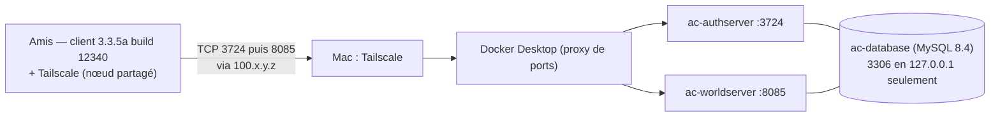

# Guide administrateur — serveur AzerothCore 3.3.5a privé (macOS + Docker + Tailscale)

Adapté à **cette installation** : MacBook Pro M1 Max (macOS 27.0.1), projet Docker Compose
`azerothcore-wotlk`, 6 joueurs, accès distant par Tailscale sans redirection de port.

Racine du projet : `/Users/test/Documents/git/wow/azerothcore-wotlk`
Toutes les commandes ci-dessous se lancent depuis cette racine.

---

## 1. Architecture



| Élément | Emplacement / valeur |
|---|---|
| Fichier Compose | `docker-compose.yml` (upstream) + `docker-compose.override.yml` (local, non versionné) |
| Configs serveurs | `env/dist/etc/{authserver,worldserver}.conf` (générées depuis les `.dist`, non versionnées) |
| Surcharges versionnées | `conf/dist/env.ac` (variables `AC_*`, prioritaires sur les `.conf`) |
| Données de jeu | volume Docker `azerothcore-wotlk_ac-client-data` (maps, vmaps, mmaps, dbc — v20.0) |
| Base de données | volume Docker `azerothcore-wotlk_ac-database` |
| Journaux | `env/dist/logs/{Server,Auth,DBImport,Errors}.log` |
| Mot de passe root MySQL | fichier `.env` (racine, permissions 600, non versionné) |
| Client data / IP LAN | 192.168.1.74 (DHCP — réserver l'adresse sur la box) |

---

## 2. Démarrer / arrêter / redémarrer

```bash
cd /Users/test/Documents/git/wow/azerothcore-wotlk

docker compose up -d                 # démarrer (ou appliquer une modif de config)
docker compose ps                    # état + ports publiés
docker compose restart ac-worldserver   # redémarrer le serveur de jeu (30 s)
docker compose stop                  # arrêter sans supprimer
docker compose start                 # redémarrer

# ⛔ NE JAMAIS FAIRE : docker compose down -v
#    (-v supprime les volumes = base de données + données de jeu définitivement)
```

Le worldserver est prêt quand `env/dist/logs/Server.log` affiche :
`WORLD: World Initialized …` puis `… (worldserver-daemon) ready...`

> ⚠️ **Piège vérifié en conditions réelles** : l'authserver marque le royaume **hors ligne**
> à son démarrage (`UPDATE realmlist SET flag = flag | 2`), et seul un démarrage du
> **worldserver** le repasse en ligne. Donc après tout `docker compose restart ac-authserver`,
> enchaîne par `docker compose restart ac-worldserver`, sinon les clients voient « Hors ligne ».
> Contrôle : `SELECT flag FROM acore_auth.realmlist WHERE id=1;` → doit valoir `0` (bit `2` = hors ligne).

Console administrative du serveur de jeu :

```bash
docker attach ac-worldserver
#   … commandes …
# Détacher : Ctrl+P puis Ctrl+Q   (Ctrl+C ARRÊTE le serveur)
```

---

## 3. Tailscale

```bash
export PATH="/Applications/Tailscale.app/Contents/MacOS:$PATH"   # CLI (variante Standalone)
tailscale status        # pairs, état direct/relay, IP de chaque machine
tailscale ip -4         # -> 100.100.203.120  (l'adresse à mettre dans realmlist)
```

- **Installation** : `brew install --cask tailscale-app` (variante Standalone, recommandée par
  Tailscale ; ne pas installer en plus la version Mac App Store). Autoriser l'extension réseau
  dans Réglages Système → Général → Ouverture et extensions → Extensions réseau.
  ⚠️ La connexion au compte se fait **depuis la barre de menus** (icône Tailscale → *Log in*) :
  `tailscale up` en ligne de commande échoue sur macOS (« *The Tailscale GUI failed to start:
  Tailscale.CLIError error 3* »).
- **Identité de cette installation** : compte `mael.donnart.pro@gmail.com`, machine
  `macbook-pro-de-mal`, IP tailnet `100.100.203.120`, nom MagicDNS
  `macbook-pro-de-mal.tail294391.ts.net` (tailnet `tail294391`).
- **Empêcher l'expiration de la clé du serveur** : la clé de `macbook-pro-de-mal` expire le
  **16/04/2027** ; passé ce délai la machine quitte le tailnet et plus personne ne peut se connecter.
  Console d'admin → Machines → `…` → **Disable key expiry** (documentation Tailscale : « *You can
  disable key expiry for certain types of devices where this is inconvenient, like servers.* »).
  À faire aussi pour le compte partagé : si un ami disparaît du tailnet tous les 180 jours, c'est
  cette expiration, pas une panne.
- **Autoriser les connexions entrantes** : laisser l'option active
  (`tailscale set --shields-up=false`). C'est la cause n°1 d'échec « le serveur ne répond pas ».
- **Ajouter un ami** : console <https://login.tailscale.com/admin/machines> → machine du Mac →
  menu `…` → **Share** → e-mail (lien à usage unique) ou **lien réutilisable** (valable 30 jours,
  jusqu'à 1000 usages). Le partage ne consomme **aucun** siège utilisateur du tailnet et l'ami
  n'accède qu'à cette machine. L'ami doit être propriétaire/admin de son propre tailnet pour accepter.
- **Retirer un ami** : admin.tailscale.com → **Sharing** → révoquer le partage.
- **Alternative** : inviter un ami comme utilisateur du tailnet (plan gratuit = 6 utilisateurs,
  soit toi + 5 : plus aucune marge). À réserver au cas où tu veux des ACL par utilisateur.

---

## 4. Comptes de jeu

Toujours via la console du worldserver (jamais en SQL direct) :

```bash
docker attach ac-worldserver
account create <compte> <motdepasse> <email>     # une fois par joueur
account set gmlevel <ton_compte> 3 -1            # administrateur (toi uniquement)
# Ctrl+P puis Ctrl+Q pour détacher
```

Autres commandes utiles : `account list`, `account set password`, `account set addon`, `server info`.
Le niveau 3 = administrateur ; `-1` = tous les royaumes.

Vérification :

```bash
docker exec -e MYSQL_PWD="$(grep '^DOCKER_DB_ROOT_PASSWORD=' .env | cut -d= -f2-)" ac-database \
  mysql -uroot -N -e "SELECT id, username FROM acore_auth.account"
```

Comptes créés le 18/10 : `mael`, `cedric`, `marine`, `anthony`, `jess`, `felix`
(mot de passe = nom du compte, `mael` en administrateur niveau 3). À communiquer aux joueurs
oralement ou par messagerie — à ne pas recopier dans un document partagé.

> ⚠️ **Pièges constatés en conditions réelles (18/10)**
> - `docker attach` **refuse un stdin non-TTY** (« *cannot attach stdin to a TTY-enabled container
>   because stdin is not a terminal* ») : la console doit être ouverte depuis un vrai terminal.
> - Les créations de comptes sont écrites **en base de façon asynchrone** : enchaîner
>   `account set gmlevel` juste après `account create` peut viser un identifiant inexistant
>   (ligne parasite `account_access.id = 0`). Attendre 2–3 s, ou relancer la commande et vérifier
>   avec le SELECT ci-dessus.
> - Les noms de compte **et** les mots de passe sont stockés **en majuscules**
>   (`Utf8ToUpperOnlyLatin` dans `AccountMgr::CreateAccount`) : taper `mael`/`mael` fonctionne
>   normalement (le client 3.3.5a convertit la saisie), sinon essayer en majuscules.
> - Détacher la console : **Ctrl+P puis Ctrl+Q** — le client d'attache se ferme et le serveur
>   continue (vérifié : `restarts=0`, `status=running`).

> ℹ️ **État de `acore_characters` (constaté le 18/10)** : le personnage `Test` (guid 1, compte
> `MAEL`) est le seul personnage existant, mais la base contient des **lignes orphelines** :
> `character_skills` 375 lignes pour les guids 2–18, `character_spell` 274 lignes — sans
> personnage correspondant.
> **Origine** : elles ne viennent d'aucun fichier SQL du dépôt (aucun `INSERT` dans ces tables),
> et la suppression d'un personnage par le jeu est **transactionnelle** (`characters` + toutes
> les tables dépendantes, `Player.cpp:4088+`) : elle ne peut pas laisser ce résidu. La signature
> correspond donc à un **vidage ciblé de la table `characters`** (ou une restauration partielle),
> qui a laissé les tables dépendantes intactes ; les comptes de test associés ayant été
> supprimés ensuite, `account delete` n'a plus trouvé de personnages à nettoyer.
> Conséquence visible : la numérotation des guid étant repartie de 1, ton nouveau personnage
> (Night Elf) a récupéré le guid 1 d'un ancien occupant (Humain) — d'où les messages de
> validation au premier login (« skill 754 » et bouton d'action 59752, tous deux raciaux Humains,
> supprimés automatiquement). C'est sans effet en jeu.
>
> ```bash
> docker exec -e MYSQL_PWD="$(grep '^DOCKER_DB_ROOT_PASSWORD=' .env | cut -d= -f2-)" ac-database mysql -uroot -e "
>   DELETE s FROM acore_characters.character_skills s
>     LEFT JOIN acore_characters.characters c ON c.guid = s.guid WHERE c.guid IS NULL;
>   DELETE s FROM acore_characters.character_spell s
>     LEFT JOIN acore_characters.characters c ON c.guid = s.guid WHERE c.guid IS NULL;"
> ```

---

## 5. realmlist : annoncer l'adresse du serveur aux joueurs

L'authserver envoie au client l'adresse contenue dans `acore_auth.realmlist.address`, puis le client
s'y connecte directement (TCP 8085). Prise en compte automatique en ≤ 20 s (`RealmsStateUpdateDelay`).

```bash
IP=$(/Applications/Tailscale.app/Contents/MacOS/Tailscale ip -4)
NEW=$(grep '^DOCKER_DB_ROOT_PASSWORD=' .env | cut -d= -f2-)
docker exec -e MYSQL_PWD="$NEW" ac-database mysql -uroot -e \
  "UPDATE acore_auth.realmlist SET address='$IP' WHERE id=1;
   SELECT id,name,address,localAddress,localSubnetMask,port,gamebuild FROM acore_auth.realmlist;"
unset IP NEW
```

Règles :
- **`address`** = IP Tailscale (`100.100.203.120`). Une adresse littérale est préférable à un nom
  MagicDNS : l'authserver résout cette chaîne **en IPv4 au démarrage**. (Testé le 18/10 sur cette
  machine : le nom `macbook-pro-de-mal.tail294391.ts.net` **résout bien depuis le conteneur**
  — `docker exec ac-worldserver getent hosts macbook-pro-de-mal.tail294391.ts.net` → `100.100.203.120`.
  Le nom est donc utilisable et survit à un changement d'IP, mais retombe si Tailscale n'est pas
  connecté au démarrage : l'IP reste le choix le plus déterministe.)
- **`localAddress` : ne pas y toucher** (`127.0.0.1`). Documentation officielle AzerothCore :
  « *Docker only: Do not change the localAddress field from its default value.* »
- `port` = `8085`, `gamebuild` = `12340`, `allowedSecurityLevel` = `0` (tous les comptes jouent).

Logique appliquée par l'authserver (`src/server/shared/Realms/Realm.cpp:23-56`) :
client en boucle locale → son adresse ; client dans le sous-réseau `localAddress`/`localSubnetMask`
→ `localAddress` ; **tout autre client → `address`** (donc tous les joueurs Tailscale).

---

## 6. Sauvegardes

```bash
cd /Users/test/Documents/git/wow/azerothcore-wotlk
mkdir -p ~/sauvegardes-acore
docker exec ac-database sh -c 'exec mysqldump --single-transaction --all-databases -uroot -p"$MYSQL_ROOT_PASSWORD"' \
  > ~/sauvegardes-acore/db-$(date +%F-%H%M).sql
cp conf/dist/env.ac ~/sauvegardes-acore/env.ac-$(date +%F).bak
```

- À faire avant toute modification lourde, et une fois par semaine si vous jouez régulièrement.
- Les **personnages** sont dans la sauvegarde SQL. Les **données de jeu** (maps/vmaps/mmaps/dbc,
  volume `ac-client-data`, 3,2 Go) ne sont pas des données à toi : elles se retéléchargent seules
  (voir `ac-client-data-init`).
- Restauration : `docker exec -i ac-database sh -c 'exec mysql -uroot -p"$MYSQL_ROOT_PASSWORD"' < fichier.sql`
- Le fichier `.env` (mot de passe MySQL) doit être sauvegardé séparément, hors dépôt git.

---

## 7. Tests progressifs (à refaire après chaque changement réseau)

| # | Objectif | Commande / action | Résultat attendu |
|---|---|---|---|
| 1 | Services sains | `docker compose ps` ; `grep -aE "ERROR\|WARNING" env/dist/logs/*.log` | 3 conteneurs `Up`, `ac-database (healthy)`, aucune erreur |
| 2 | Connexion locale | `nc -vz 127.0.0.1 3724` ; client WoW en `127.0.0.1` | port ouvert, connexion OK |
| 3 | Tailscale entre 2 machines | sur le Mac : `tailscale status` ; chez l'ami : `tailscale ping <machine>` | pair `active; direct` (sinon `relay`, jouable mais plus lent) |
| 4 | Ports nécessaires | depuis la machine de l'ami : `nc -vz <IP> 3724` et `nc -vz <IP> 8085` ; `nc -vz <IP> 3306` | 3724 et 8085 **ouverts**, 3306 **fermé** |
| 5 | Authentification | lancement du client chez l'ami | royaume **AzerothCore en ligne** ; `Auth.log` trace la session |
| 6 | Entrée dans le monde | création d'un personnage, entrée en jeu | chargement complet ; `Server.log` trace la connexion |
| 7 | Charge simultanée | 5 amis + toi connectés | pas de déconnexion ; `tailscale status` direct pour tous |

Vérifier aussi qu'aucun port n'est ouvert sur Internet (aucune redirection sur la box) :
console de la box (192.168.1.254) → NAT/redirection de ports et UPnP → aucune règle vers le Mac.

### Diagnostics

| Symptôme | Cause probable | Commande / correctif |
|---|---|---|
| « Unable to validate game version » | build client ≠ 12340 | contrôle du build ; `SELECT * FROM acore_auth.build_info` |
| Royaume « Hors ligne » | worldserver pas prêt, ou build différent du `gamebuild` | `tail -50 env/dist/logs/Server.log` ; `docker compose restart ac-worldserver` |
| Liste de royaumes vide | `address` non résoluble → royaume ignoré | `grep -i "could not resolve" env/dist/logs/Auth.log` |
| Authentification OK puis blocage | port 8085 injoignable (Tailscale, pare-feu, mauvais `address`) | `nc -vz <IP> 8085` ; vérifier `realmlist` ; `tailscale set --shields-up=false` |
| Personne ne peut se connecter | Mac en veille | `caffeinate -s` ou régler la veille (voir §8) |
| Erreurs MySQL | mot de passe désynchronisé entre `.env` et la base | `docker exec ac-database sh -c 'mysql -uroot -p"$MYSQL_ROOT_PASSWORD" -e "SELECT 1"'` |

---

## 8. Robustesse au quotidien

- **Veille** : par défaut cette machine s'endort au bout d'1 minute d'inactivité → serveur et
  tunnel Tailscale coupés. Sur secteur : `sudo pmset -c sleep 0`, ou lancer `caffeinate -s`
  pendant les sessions. Capot fermé = serveur hors ligne.
- **Espace disque** : 97 % utilisés. Surveiller `df -h /`, `docker system df`.
- **Journaux** : pas de rotation (les `.log` sont écrasés à chaque redémarrage) — normal pour
  ce type de serveur, mais aucune historique au-delà d'un démarrage.
- **Images Docker** : ne pas mettre à jour `mysql:8.4` sans sauvegarde préalable.

---

## 9. Maintenance du code et des personnalisations

Modifications locales actuelles (commits au-dessus de l'upstream) :

| Sujet | Où | Effet |
|---|---|---|
| Groupes de 6 | `src/server/game/Groups/*`, `Map.cpp` | 6 joueurs par groupe, raid toujours à 40, LFG limité à 5 |
| Créatures vanilla-like | `conf/dist/env.ac` (`AC_RATE_CREATURE_*`) | normaux ×1,35 dégâts / ×1,20 PV / ×1,30 sorts ; élites ×1,40 / ×1,50 / ×1,30 ; partout y compris instances |
| Régénération −20 % | `conf/dist/env.ac` (`AC_RATE_HEALTH`/`AC_RATE_MANA`) | ticks de vie/mana des joueurs ×0,8 |
| Familiers standard | `Creature.{h,cpp}`, `ObjectMgr.cpp`, `StatSystem.cpp`, `Unit.cpp` | familiers/gardiens/totems exclus des taux monstres (corrige le ×1,35 accidentel) |
| Monstres rouges vanilla | `data/sql/updates/db_world/2026_10_22_00.sql` | 138 factions restaurées (rouges 1.12.1 devenus jaunes) |
| Mort définitive | Module `modules/mod-challenge-modes` (dépôt cloné, patché local) | opt-in par personnage via le Shrine of Challenge (niveau 1 / DK ≤ 55) ; annonces serveur ; journal `hardcore_deaths` ; sauvetage GM `.hardcore revive` |
| Faim et soif | Module `modules/mod-hunger-thirst` (dépôt git séparé, cloné à cet emplacement, non suivi par le dépôt du serveur) + `env/dist/etc/modules/mod_hunger_thirst.conf` | jauges satiété/hydratation, `Mode = off` par défaut ; table `hunger_thirst_state` ; commandes GM `.hungerthirst set/reset` |
| XP −10 % | `conf/dist/env.ac` (`AC_RATE_XP_*`) | −10 % sur kills, quêtes, exploration, objectifs BG |

Après une modification de code : `docker compose build ac-worldserver ac-authserver && docker compose up -d`
(prévoir de l'espace disque et plusieurs dizaines de minutes ; ne pas interrompre).

Après l'ajout d'un fichier `data/sql/updates/db_world/*.sql`, reconstruire aussi l'image d'import
(les updates y sont embarqués, il n'y a pas de volume de données monté) :
`docker compose build ac-db-import && docker compose up -d`. Le service `ac-db-import` applique les
fichiers manquants au démarrage et enregistre leur hash dans `acore_world.updates`. Le worldserver, lui,
tourne avec `AC_UPDATES_ENABLE_DATABASES=0` et n'applique rien.

⚠️ **Piège du fichier de conf monté** : `apps/docker/entrypoint.sh` copie les `.conf.dist` avec
`cp -n` (jamais d'écrasement). Après un rebuild, un nouveau fichier monté ne recevra **pas** les
nouvelles clés de configuration. Si une nouvelle option n'apparaît pas dans
`env/dist/etc/worldserver.conf`, ajoute-la à la main ou régénère ce fichier depuis le `.dist`
de l'image (`docker exec ac-worldserver cat /azerothcore/env/ref/etc/worldserver.conf.dist`).
Les variables `AC_*` de `conf/dist/env.ac`, elles, s'appliquent **sans** modification du fichier
(elles sont lues dans l'environnement, y compris pour une clé absente du `.conf`).

### Module faim et soif (`mod-hunger-thirst`)

- **Dépôt séparé** : le module vit désormais dans son propre dépôt git, cloné dans
  `modules/mod-hunger-thirst`. Il n'est **pas** versionné dans le dépôt du serveur : un
  `git clone` de ce dernier ne le contient pas. Conséquence : après un nouveau clone du dépôt
  du serveur, cloner d'abord le module à cet emplacement **avant**
  `docker compose build ac-worldserver`, sinon l'image est construite sans lui. Pour mettre à
  jour le module : `git -C modules/mod-hunger-thirst pull`, puis reconstruire l'image.
- **Config** : `env/dist/etc/modules/mod_hunger_thirst.conf`, créé au démarrage Docker depuis
  le `.conf.dist` installé dans l'image (`/azerothcore/env/ref/etc/modules/mod_hunger_thirst.conf.dist`
  dans le conteneur) — l'entrypoint copie désormais chaque `modules/*.conf.dist` manquant vers
  son `.conf`, sans écraser un fichier existant.
  Le module est livré avec `Enable = 1` mais **`Mode = off` par défaut** : il est installé et
  sans effet tant que le mode n'est pas changé. Modes : `off`, `advisory` (jauges, messages et
  résumé de login, **aucun dégât**) et `survival` (dégâts dès qu'une jauge entre dans la bande
  critique, `<= CriticalThreshold`, 10 par défaut : `StarvingDamagePct` toutes les
  `StarvingIntervalMs` ; dès qu'une jauge est à 0, `DehydratedDamagePct` toutes les
  `DehydratedIntervalMs` ; les deux à 0 appliquent `DoubleEmptyMultiplier` une seule fois).
  `Lethal = 0` par défaut : même en `survival`, les dégâts ne peuvent pas tuer (plancher 1 PV) ;
  `Lethal = 1` autorise la mort, donc la mort définitive pour un personnage hardcore.
  En champ de bataille et en arène, les dégâts d'épuisement sont **toujours** supprimés, même si
  `PauseInBattleground = 0` ou `PauseInArena = 0` ; ces deux clés ne contrôlent que la
  décroissance, les alertes et les mises à jour addon.
  Rechargement à chaud : `.reload config` (sinon `docker compose restart ac-worldserver`) ; les
  changements s'appliquent au tick suivant. Exception : passer `Enable` de `0` à `1` ne charge
  pas l'état des joueurs déjà en ligne — ils doivent se reconnecter ou être initialisés avec
  `.hungerthirst set` (les nouvelles connexions sont normales).
- **Table** : `acore_characters.hunger_thirst_state` (`guid`, `satiety`, `hydration`,
  `updated_at`), créée automatiquement au démarrage — aucun SQL à importer. Pour repartir de
  zéro, utiliser `.hungerthirst reset` (ou supprimer la ligne d'un personnage **hors ligne**).
  Si la table ne peut pas être créée/vérifiée, la simulation est suspendue pour les joueurs
  concernés (aucun tick, sauvegarde, crédit ni mise à jour périodique de l'addon) sans jamais
  bloquer la connexion. En mode actif, le joueur reçoit « Persistance indisponible » (si le
  résumé de login est activé) ; l'addon affiche le même état.
  Une reconnexion est nécessaire une fois la table restaurée.
- **Commandes GM** (en jeu uniquement, cible **en ligne** obligatoire) :

  ```text
  .hungerthirst                                # état du personnage (accessible à tous)
  .hungerthirst status                         # idem, sous-commande explicite
  .hungerthirst help                           # rappel des sous-commandes
  .hungerthirst set <joueur> <satiété> <hydratation>   # valeurs bornées 0–100
  .hungerthirst reset <joueur>                 # retour aux valeurs de départ (100/100 par défaut)
  ```

- **Addon client** : livré dans le dépôt du module, dossier
  `modules/mod-hunger-thirst/client/Interface/AddOns/HungerThirst` (nom affiché
  **Hunger & Thirst**) ; les joueurs le copient dans `Interface/AddOns/` de leur client et
  utilisent `/hungerthirst` (ou `/ht`), `/hungerthirst icons` et `/hungerthirst reset`.
- **Rebuild Docker** après le clone initial ou une mise à jour du module :
  `docker compose build ac-worldserver && docker compose up -d`.

---

## 10. Sécurité — état actuel

| Point | État |
|---|---|
| Ports exposés sur le Mac | `3724` (auth) et `8085` (jeu) sur toutes les interfaces ; `3306` **uniquement sur 127.0.0.1** |
| Port SOAP `7878` | non publié ; `SOAP.Enabled = 0` |
| Mot de passe root MySQL | aléatoire 32 caractères, dans `.env` (chmod 600, ignoré par git) |
| Accès réseau au serveur | uniquement les appareils du tailnet ayant accepté le partage ; aucun port ouvert sur Internet |
| Pare-feu macOS | désactivé (état d'origine) — suffisant ici, puisque rien n'est publié sur Internet |
| `WrongPass.MaxCount` | `0` (limitation du bruteforce désactivée) — sans objet tant que l'accès reste Tailscale-only |
| Comptes `root@%` | existe mais n'est joignable que depuis 127.0.0.1 |

Changer le mot de passe MySQL si nécessaire :

```bash
cd /Users/test/Documents/git/wow/azerothcore-wotlk
OLD=$(docker exec ac-database printenv MYSQL_ROOT_PASSWORD)
NEW=$(LC_ALL=C tr -dc 'A-Za-z0-9' < /dev/urandom | head -c 32)
printf 'DOCKER_DB_ROOT_PASSWORD=%s\n' "$NEW" > .env && chmod 600 .env
docker exec -e MYSQL_PWD="$OLD" ac-database mysql -uroot -e \
  "ALTER USER 'root'@'%' IDENTIFIED BY '$NEW'; ALTER USER 'root'@'localhost' IDENTIFIED BY '$NEW';"
docker compose up -d --no-deps ac-database ac-worldserver ac-authserver
unset OLD NEW
```

---

## 11. Commandes GM essentielles

**En jeu**, préfixe `.` obligatoire (ex. `.server info`). **Dans la console** (`docker attach`),
pas de point (ex. `server info`) — et seules les commandes autorisées en console y fonctionnent
(`Console::Yes` dans le code ; `.gm on`, `.learn`, `.group revive` sont en jeu uniquement).

Réflexes de départ : `.commands` (liste tout ce que ton niveau autorise) et `.help <commande>`.

### Réanimer un personnage — le plus important ici (mode Hardcore)

```text
.hardcore revive [nom_du_personnage]   # cible sélectionnée sinon soi-même ; fonctionne SUR UN PERSONNAGE HORS LIGNE
.hardcore status                       # état Hardcore du personnage (accessible à tous)
```

`.hardcore revive` est la **seule** façon de sortir de la mort définitive : ni esprit guérisseur,
ni récupération de cadavre, ni résurrection par un sort ou par un autre joueur — et `.revive` /
`.group revive` ne marchent pas sur un personnage Hardcore tombé. La commande cible le personnage
sélectionné, sinon toi-même, et fonctionne sur un personnage **hors ligne** : la résurrection est
alors enregistrée et devient effective à sa prochaine connexion. Le personnage **reste Hardcore** :
sa prochaine mort est de nouveau définitive. `.hardcore status` affiche l'état du personnage
(`Hardcore : ACTIVÉ`, `Hardcore : TOMBÉ` ou `Hardcore : désactivé`).

Le mode Hardcore est **opt-in par personnage** via le Shrine of Challenge (voir §9) : seuls les
personnages qui l'ont activé connaissent la mort définitive. Le module `mod-challenge-modes` se
configure dans `env/dist/etc/modules/challenge_modes.conf` :

- `ChallengeModes.Enable = 1` — active le module de défis ;
- `Hardcore.Enable = 1` — active le défi Hardcore ;
- `Hardcore.AnnounceDeaths = 1` — annonce chaque mort Hardcore à tout le serveur ;
- `Hardcore.LogDeaths = 1` — journalise chaque mort dans `hardcore_deaths` ;
- tous les autres `*.Enable = 0` (`SemiHardcore`, `SelfCrafted`, `ItemQualityLevel`, `SlowXpGain`,
  `VerySlowXpGain`, `QuestXpOnly`, `IronMan`) : seuls les défis activés apparaissent au Shrine.

Prérequis : `EnablePlayerSettings = 1` dans `env/dist/etc/worldserver.conf` — sans lui, les réglages
de défi ne sont pas conservés d'une connexion à l'autre. Le Shrine of Challenge et son texte
français viennent de deux SQL à importer **manuellement** dans `acore_world` (le serveur peut rester
allumé ; le sanctuaire apparaît après redémarrage) :

```bash
docker exec -i ac-database sh -c 'mysql -uroot -p"$MYSQL_ROOT_PASSWORD" acore_world' \
  < modules/mod-challenge-modes/data/sql/db-world/base/challenge_mode_gobject.sql
docker exec -i ac-database sh -c 'mysql -uroot -p"$MYSQL_ROOT_PASSWORD" acore_world' \
  < modules/mod-challenge-modes/data/sql/db-world/base/challenge_mode_gossip_fr.sql
```

Journal des morts : table `hardcore_deaths` (base `acore_characters`), créée automatiquement au
démarrage du worldserver.

> ℹ️ **Base de personnages remise à zéro** : tous les personnages ont été effacés pour repartir de
> zéro (les comptes et les tables système sont conservés). Le personnage du bot d'hôtel des ventes
> a disparu avec eux : l'AH bot est donc **désactivé** tant qu'un nouveau personnage bot n'existe
> pas. Pour le réactiver : créer un personnage, relever son guid
> (`SELECT guid, name FROM characters ORDER BY guid DESC LIMIT 5;`), puis renseigner
> `AuctionHouseBot.GUIDs = <guid>` et `AuctionHouseBot.EnableSeller = true` dans
> `env/dist/etc/modules/mod_ahbot.conf`, et redémarrer `ac-worldserver`
> (`docker compose restart ac-worldserver`).

### Serveur

```text
.server info                          # version, joueurs connectés, uptime
.saveall                              # force la sauvegarde (à faire avant un arrêt manuel)
.server shutdown #delay [#exit_code]  # ex. .server shutdown 30s
.server restart #delay                # ex. .server restart 1m
.server motd                          # message du jour
.announce $message                    # message global (fenêtre de chat)
.notify $message                      # message global (bandeau écran)
.reload config                        # recharge worldserver.conf à chaud
```

### Comptes

```text
.account onlinelist                          # qui est connecté
.account info $account                       # infos d'un compte
.account create $account $password $email    # $email optionnel
.account set password $account $pass $pass
.account set gmlevel [$account] #level #realmID   # (ne fonctionne pas sur soi-même)
.account lock ip [on|off]                    # n'autoriser la connexion que depuis l'IP courante
```

### Modération

```text
.kick [$characterName] [$reason]
.ban account $name $bantime $reason      # temps "4d2h30m", valeur négative = permanent
.ban character $name $bantime $reason
.unban account $name
.mute [$playerName] $muteTime [$reason]
```

### Téléporter des joueurs

```text
.teleport $lieu                                  # te téléporte toi
.teleport name [$joueur] $lieu                   # téléporte un autre joueur (même HORS LIGNE)
.teleport name [$joueur] $home                   # ... à sa pierre de foyer
.teleport name npc name|id|guid [$joueur] $pnj   # ... devant un PNJ précis
.teleport group $lieu                            # toi + ton groupe (ou le groupe du joueur sélectionné)
.summon [$joueur]                                # l'amène à toi (marche hors ligne)
.groupsummon [$joueur]                           # l'amène lui + son groupe
.appear [$joueur]                                # toi vers lui (marche hors ligne : sa dernière position)
.unstuck [$joueur] [inn|graveyard|startzone]     # débloque un joueur (défaut : sa pierre de foyer)
.teleport add $nom   |   .teleport del $nom      # ajoute/retire ta position actuelle à la liste des lieux
.lookup teleport $motif                          # retrouve le nom exact d'un lieu
```

Les préfixes uniques fonctionnent : `.tele` = `.teleport`. Le joueur peut être désigné par son nom
**ou** sélectionné à la souris. Pour un lieu précis, il doit exister dans la liste des lieux
(`.lookup teleport ...`) — il n'y a pas de téléport par coordonnées pour un tiers : dans ce cas
`.go xyz` jusqu'au point voulu, `.teleport add $nom`, puis `.teleport name $joueur $nom`.

### Déplacements, recherche, contenu

```text
.lookup item|creature|spell|tele $nom        # renvoie les ID
.go creature $guid | .go xyz #x #y [#z [#mapid [#orientation]]]
.additem [#itemID|#itemLink] [#count]
.learn #spell [all]        .quest complete #questid        .aura #spellid
.character level [$name] [#level]     .character rename    .character customize
.character deleted list|restore $name #guid
.wchange #weathertype #grade
```

### Mode GM / tests

```text
.gm on | .gm off          # active le statut GM
.gm visible on|off        # visible/invisible pour les joueurs
.gm fly on|off
.cheat god on|off | .cheat cooldown on|off | .cheat casttime on|off
.modify speed $type #rate | .modify hp #hp | .modify money #money | .modify scale #rate
.die                      # se tuer (utile pour tester la mort définitive... sur un personnage de test)
```

### Envois par courrier

```text
.send items #player "#subject" "#text" itemid1[:count1] itemid2[:count2]
.send money #player "#subject" "#text" #money
```
